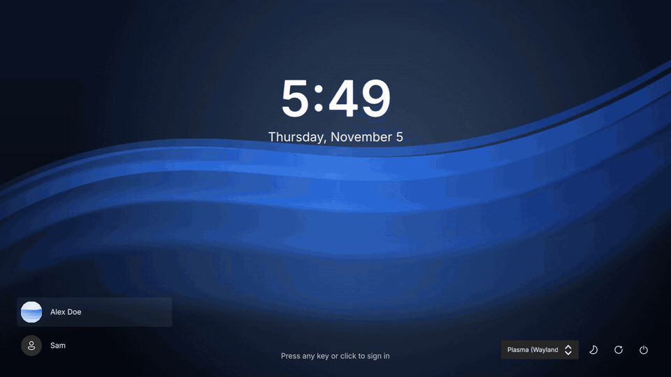
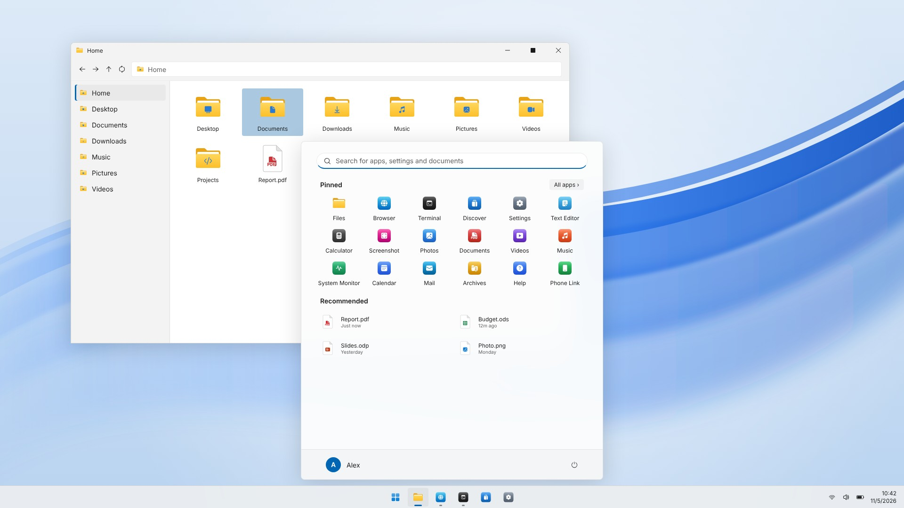
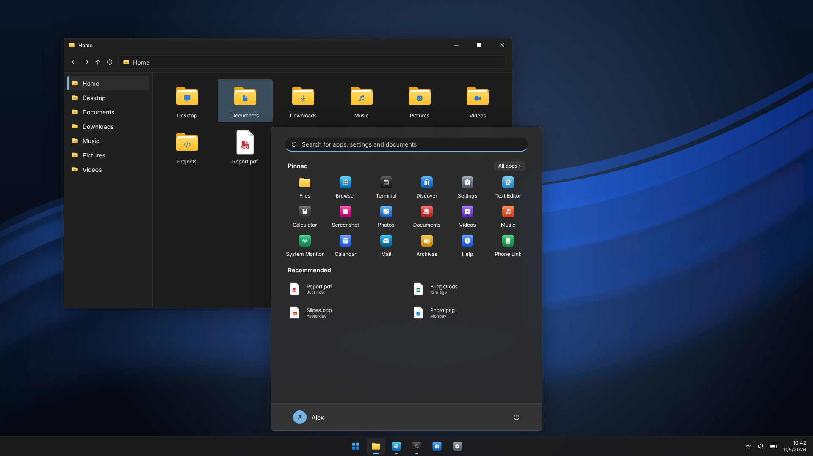
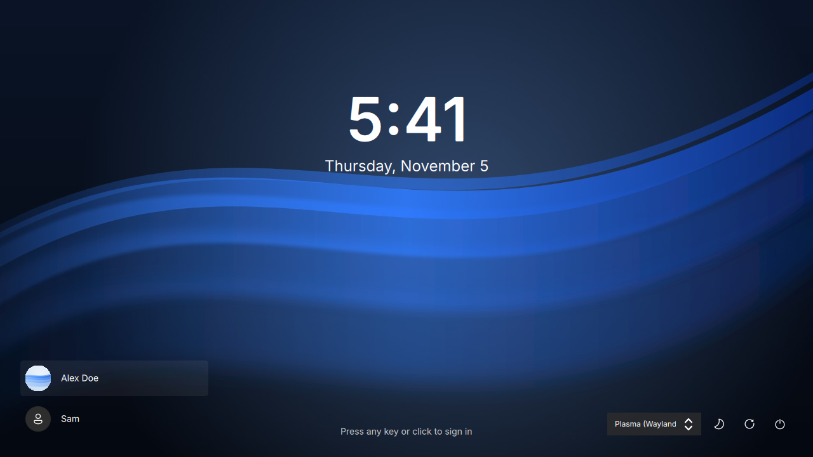
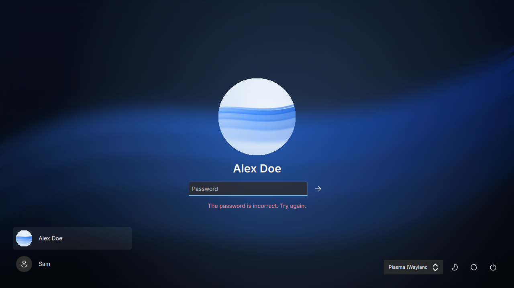
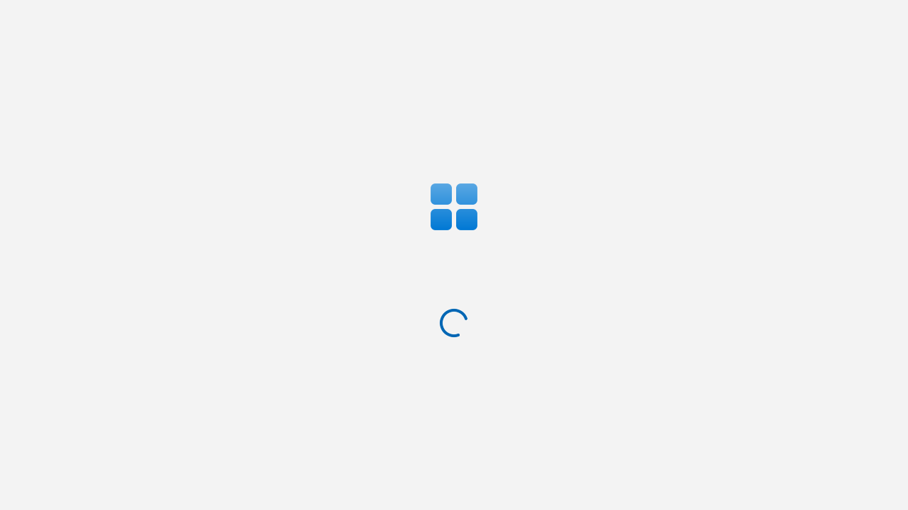
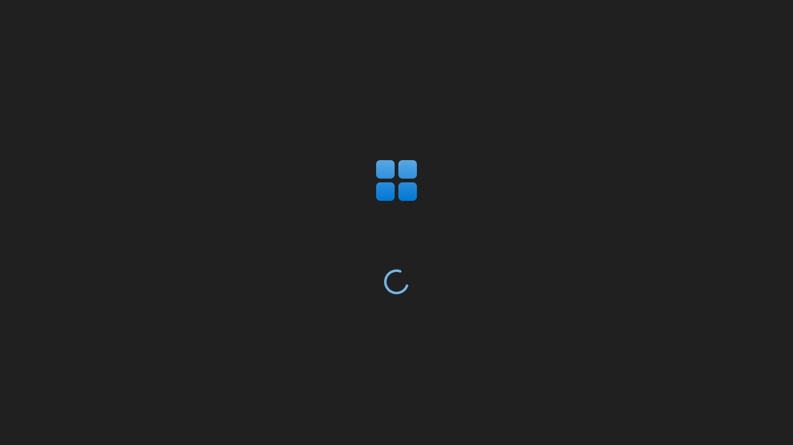
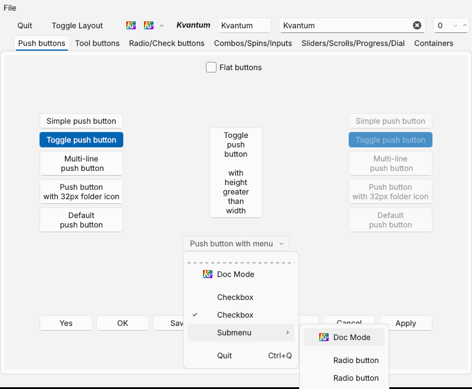
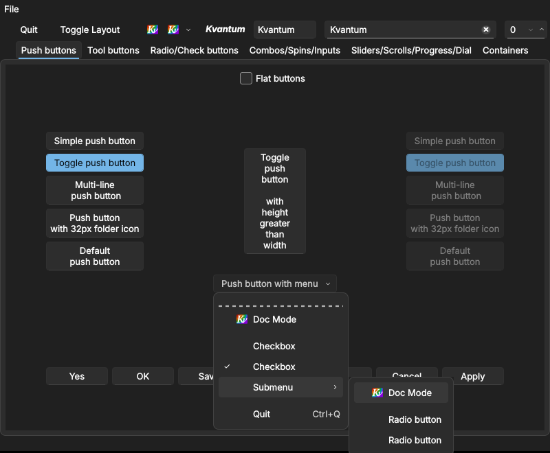

# kde-win11

A Windows 11 style desktop theme for KDE Plasma 6 on Wayland: global themes,
Plasma style, window decorations, color schemes, a Fluent icon theme, cursors,
wallpaper, boot splash and an SDDM login screen, in light and dark.

Plasma only reads the generated files under `packages/` (SVG, INI, QML and
Xcursor). Node is used to build and check them, the same way
[qs-win-11](https://github.com/0x42697262/qs-win-11) builds its shell.



[Watch the sharper MP4](docs/media/demo.mp4) · the login and splash parts are the shipped QML recorded frame by frame through Qt 6 (Mesa OpenGL); the desktop part is the mockup driven in Chromium with the theme's own cursors.

| | |
|---|---|
|  |  |
|  |  |
|  |  |
|  |  |

The desktop images are mockups rendered by `npm run render` from the generated
colors, icons, caption buttons and wallpaper; they are not captures of a live
Plasma session. The login and splash images are the shipped QML rendered by
Qt 6 through `tools/ci/qml-preview.py`. The menu and control images are the
generated Kvantum themes in Kvantum's own `kvantumpreview` (no compositor, so
no menu shadow).

## What you get

| Package | Windows 11 look |
|---|---|
| Global themes | "Windows 11 Light" and "Windows 11 Dark" wire everything below together and lay out a 48 px bottom taskbar: Start and pinned apps centered, tray, two-line clock, show desktop |
| Plasma styles | Flat taskbar with a hairline border, 8 px rounded acrylic flyouts and tooltips with soft shadows, grey and accent task pills, list highlights with an accent pill |
| Window decorations | 32 px title bar in the window color, rounded top corners, 46 px caption buttons, red close hover |
| Color schemes | Mica window colors, accent selection with the Windows light/dark accent shades, Windows title bar colors |
| Icons | About 500 symbolic names from Fluent UI System Icons that follow the color scheme, plus original yellow folders, document pages and gradient app tiles |
| Cursors | Original white or black arrow, hand, I-beam, resize and move cursors at 24 to 64 px, with a spinning accent busy ring |
| Wallpaper | Original ribbons, with a dark variant |
| Splash | Start glyph above a spinning accent ring |
| Login screen | SDDM theme with the lock clock, blurred wallpaper, avatar, password field, user list, session picker and power buttons |
| Menus and controls (optional) | Kvantum style: rounded menus with shadow and inset hover, Fluent check marks and chevrons, Windows 11 buttons, fields, check boxes, sliders, scrollbars and tabs; all KDE menu entries kept |
| Konsole | Windows Terminal Campbell and One Half Light palettes |

The lock screen stays Breeze, recolored by the color scheme; see
[ADR 0008](docs/adr/0008-keep-breeze-lock-screen-and-widgets.md). Apps keep
Breeze unless you add `--kvantum`; see
[ADR 0009](docs/adr/0009-optional-kvantum-style.md).
No Microsoft artwork, fonts or logos are included; see
[ADR 0002](docs/adr/0002-open-assets.md).

## Requirements

- KDE Plasma 6 (Wayland or X11)
- Optional: the Inter font for the splash and login screen, SDDM with Qt 6 for
  the login screen, Kvantum for Qt 6 for Windows 11 menus and controls, Node 22
  to rebuild with your own settings

## Install

```bash
git clone https://github.com/0x42697262/kde-win11
```

```bash
cd kde-win11 && tools/install.sh
```

`install.sh` copies the packages into `$XDG_DATA_HOME` and applies the light
global theme with its taskbar layout. Use `--dark` for the dark theme,
`--keep-layout` to keep your own panels, `--no-apply` to only copy files and
`--sddm` to also install and select the login screen (uses `sudo`) and
`--kvantum` for Windows 11 menus and controls in apps (needs Kvantum for Qt 6,
packaged as `kvantum` on most distributions). Remove
everything again with:

```bash
tools/install.sh --uninstall
```

Prefer clicking? Copy each folder under `packages/` into `~/.local/share/` and
pick "Windows 11 Light" in System Settings → Colors & Themes → Global Theme with
"Use desktop layout from theme" checked.

## Configure

Settings live in `$XDG_CONFIG_HOME/kde-win11/settings.json` and only hold what
you change, for example:

```json
{
    "schemaVersion": 1,
    "values": {
        "accent": { "color": "#e3008c" },
        "taskbar": { "alignment": "left" },
        "titlebar": { "alignment": "center" }
    }
}
```

Every color, size, corner radius, shadow, cursor size and text is a setting;
all of them are listed in [`docs/configuration.md`](docs/configuration.md).
Run `tools/install.sh` again and it rebuilds the theme with your settings when
Node is available. Invalid values fall back to their defaults and are printed
as `settings.invalid`.

## Develop

```bash
npm ci
```

```bash
npm run verify
```

`verify` runs the type check, the banned-pattern check, the domain tests and
the generated-files check. `npm run gen` regenerates `packages/`,
`npm run render` re-renders the JPEG and PNG images with Playwright and
`tools/demo.sh` records the README demo (needs PySide6, a display with OpenGL,
Playwright and ffmpeg). CI also
installs every package with `kpackagetool6` on Arch Linux, xmllints every SVG
and loads the splash and login QML with zero warnings allowed. Read
[`AGENTS.md`](AGENTS.md) before changing code.

## License

GPL-3.0. Icons: Fluent UI System Icons (MIT). Fonts are not bundled.
